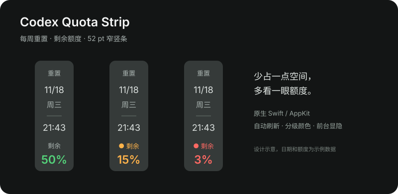

# Codex Quota Strip

**把每周重置时间和剩余额度，放进一条不抢空间的 macOS 竖条。**

Codex Quota Strip 是为 Codex / ChatGPT 桌面端制作的轻量原生小工具。它将重置日期、星期、时间和剩余百分比上下排列，方便手动放在窗口左侧的空隙中，工作时一眼就能看到本周还剩多少额度、什么时候恢复。



[下载最新版本](https://github.com/962076852/codex-quota-strip/releases/latest) · [提交问题](https://github.com/962076852/codex-quota-strip/issues) · [更新记录](CHANGELOG.md)

## 它能做什么

- **窄竖条布局**：窗口为 52 × 148 pt，没有标题栏、Dock 图标和常驻按钮。
- **每周重置时间**：显示日期、星期和小时分钟，统一使用北京时间（Asia/Shanghai）。
- **剩余额度直显**：直接显示每周剩余百分比，不必悬停或打开设置。
- **颜色提醒**：额度越低越显眼，低额度还会增加一个小色点。
- **自动刷新**：每两分钟读取一次；同时接收当前 App Server 连接推送的额度更新。
- **随使用状态显隐**：Codex 在前台时显示，退出或切换其他应用时隐藏。
- **记住位置**：拖动竖条任意文字即可定位，下次启动恢复上次位置。
- **右键操作**：立即刷新、查看使用说明或退出。
- **可选登录启动**：安装脚本可配置后台助手在登录后自动运行。

### 额度颜色

| 每周剩余 | 显示方式 |
| --- | --- |
| 高于 20% | 绿色百分比 |
| 6%–20% | 橙色百分比 + 色点 |
| 5% 及以下 | 红色百分比 + 色点 |
| 数据过期或刷新失败 | 灰色，标注“上次剩余” |

颜色阈值按界面四舍五入后的整数百分比判断。没有可用数据时显示 `—`，不会当成 0%。

## 使用要求

- macOS 13 或更高版本；已在 Apple Silicon / macOS 27.2.1 上实测。Intel 构建可生成，但尚未进行实机验证。
- 已安装并登录支持 App Server 的 Codex / ChatGPT 桌面客户端。
- 默认检测 `/Applications/ChatGPT.app` 和 `/Applications/Codex.app` 内的 Codex CLI。
- 需要账户提供通用每周额度数据；API Key 登录或模型专属限额不保证可用。

本项目是独立社区工具，与 OpenAI 无隶属关系。

## 快速开始

### 下载应用

1. 到 [Releases](https://github.com/962076852/codex-quota-strip/releases/latest) 下载 ZIP 并解压。
2. 将 `Codex Quota Strip.app` 放到“应用程序”或自己的 `~/Applications` 目录中，双击运行。
3. 将 Codex 切换到前台，拖动竖条到合适的空隙即可。

发布包使用本地 ad-hoc 签名，**未经过 Apple Developer ID 签名及公证**。若系统阻止打开，可先审阅源码并在本机自行构建；无需关闭系统安全保护。

直接打开应用不会设置登录启动。右键选择“退出时间条”后，后台助手会退出；再次打开应用即可恢复。

### 从源码构建

先安装 Apple Command Line Tools（已装 Xcode 的用户可直接构建）：

```sh
xcode-select --install
git clone https://github.com/962076852/codex-quota-strip.git
cd codex-quota-strip
./scripts/test.sh
./scripts/build.sh
open "dist/Codex Quota Strip.app"
```

生成 Universal 包（Apple Silicon + Intel）：

```sh
./scripts/build.sh --universal
```

构建产物位于 `dist/`，包括 `.app`、ZIP 及 SHA-256 校验文件。没有第三方 Swift 包或运行时依赖。

### 安装并随登录启动

在源码目录中执行：

```sh
./scripts/install.sh
```

脚本将应用复制到 `~/Applications/Codex Quota Strip.app`，并创建当前用户的 LaunchAgent。Codex 不在前台时，后台助手保留运行但不显示竖条；Codex 退出后会关闭额度查询子进程，等待下次启动。

### 卸载

```sh
./scripts/uninstall.sh
```

只移除本项目安装的应用和登录启动项，保留窗口位置偏好；不会更改 Codex 本身。

## 数据从哪里来

工具启动 Codex 自带的 `app-server --listen stdio://`，完成初始化后，通过 `account/rateLimits/read` 读取当前已登录账户的额度，并监听 `account/rateLimits/updated`。

- 优先使用 `rateLimitsByLimitId.codex`，兼容旧版 `rateLimits`。
- 从主、次窗口中识别 10,080 分钟的每周周期。
- 剩余百分比由 `100 - usedPercent` 计算，重置时间直接使用服务端返回的 `resetsAt`。
- 没有每周窗口时明确显示不可用，不拿其他模型额度替代。
- 查询通道是本机标准输入输出，工具不开放调试端口。
- 小工具不直接读取或存储登录凭据，不采集对话内容；账户认证及额度请求由已有 Codex CLI 处理。
- 不修改安装包、不注入 Codex 页面、不消耗重置次数、不购买额度。

协议参考：[OpenAI App Server 文档](https://learn.chatgpt.com/docs/app-server)。

如果 CLI 安装在自定义位置，可在直接启动时指定：

```sh
CODEX_CLI_PATH="/absolute/path/to/codex" \
  "dist/Codex Quota Strip.app/Contents/MacOS/CodexQuotaStrip"
```

该环境变量不会自动写入登录启动配置；自动启动场景需自行配置 LaunchAgent 的 `EnvironmentVariables`。

## 当前边界

- **这是独立悬浮竖条，不会嵌入 Codex 原生侧栏，也不会跟随 Codex 窗口移动。** 移动或调整 Codex 窗口后，可能需要重新拖动竖条。
- 显隐依据应用是否在前台，并不检查具体窗口是否被最小化，也不会识别多个 Codex 窗口的位置。
- 时间目前固定为北京时间，暂未提供时区设置。
- 额度属于账户级数据，不是当前聊天的消耗；活动、重置及服务端规则可能改变下次重置时间。
- 仅读取通用每周额度，不显示 5 小时额度、模型专属额度或 Token 明细。
- 后台助手需要保持运行，才能在下次进入 Codex 时自动显示。

## 开发

```text
Sources/QuotaModel.swift       每周额度解析和颜色等级
Sources/main.swift            原生窗口、查询连接及生命周期
Tests/QuotaModelTests.swift   主次窗口、缺失数据和颜色阈值检查
scripts/                      构建、测试、安装、卸载
```

欢迎提交兼容性反馈。报告问题时请注明 macOS、芯片架构、Codex 版本和现象，不要上传登录凭据或完整会话日志。

设计灵感参考 [Codex Skin Launcher](https://github.com/Tangc/codex-skin-launcher)；本项目使用独立的 Swift / AppKit 实现。

## English

A small native macOS utility that shows your Codex weekly reset date, time and remaining quota in a **52 × 148 pt vertical floating strip**. Green, orange and red tiers make low quota easy to spot. It refreshes through the installed Codex App Server and appears while Codex is in the foreground.

Drag to position, right-click to refresh or quit. Beijing time is currently fixed. This is an independent floating window: it does not patch Codex, inject UI, or follow the Codex window. Build with `./scripts/build.sh`; optionally enable login startup with `./scripts/install.sh`.

## License

[MIT](LICENSE)
